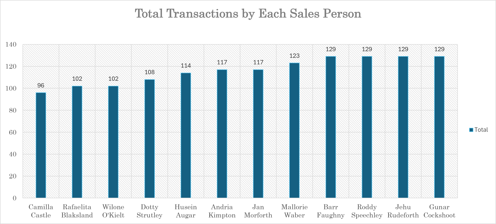
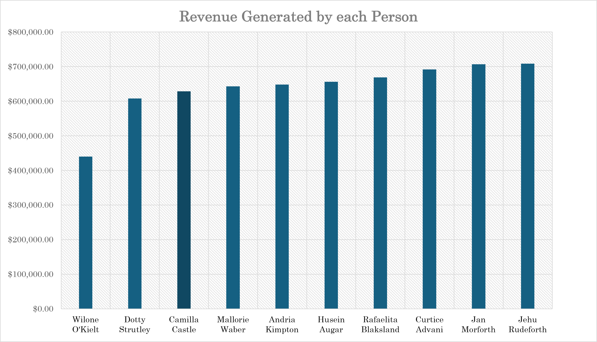
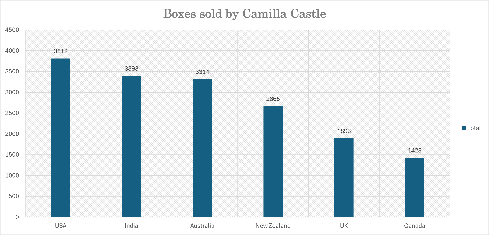
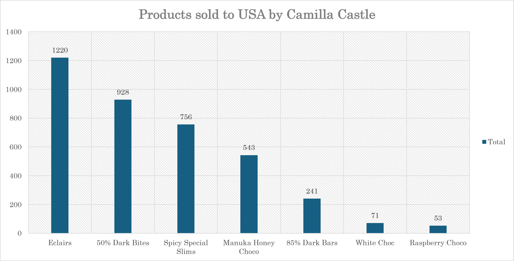
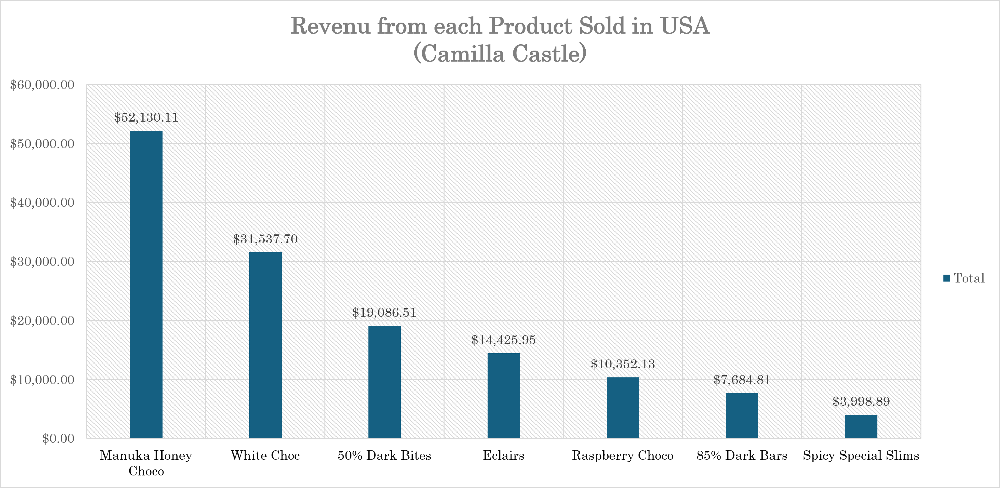
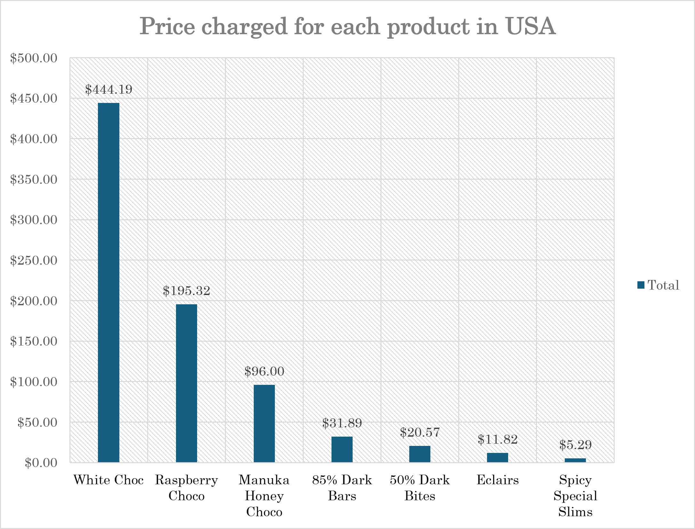

# 🍫 The Case of Camilla Castle
### Fewest deals on the team, but not the weakest seller: an Excel pivot-table analysis

> **TL;DR:** Camilla Castle closed the fewest deals of all 25 salespeople (96) and ranks 23rd in revenue. Yet her **average deal ($6,548) is above the team median ($6,191)**. The data suggests her problem is **opportunity, not ability**. She also earns **much more per box in Canada and New Zealand** than in her highest-volume markets, so counting boxes alone undervalues her work.

---

## 📌 Project overview

| | |
|---|---|
| **Tool** | Microsoft Excel (Pivot Tables, Pivot Charts, Calculated Fields) |
| **Dataset** | Chocolate sales transactions: 3,282 rows, 25 salespeople, 6 countries, 22 products, Jan–Aug 2022–2024 |
| **Fields** | Sales Person, Country, Product, Date, Amount ($), Boxes Shipped |
| **Question** | How does one salesperson's performance look when you dig past the leaderboard? |

The salesperson names in this dataset are fictional.

---

## 1️⃣ The leaderboard: Camilla is at the bottom

Camilla recorded **96 transactions**, the fewest on the team. The busiest rep (Kelci Walkden) recorded 162.

On revenue she sits **23rd of 25** with **$628,613**. A manager looking only at these two charts would label her a low performer.

---

## 2️⃣ The twist: her deals are bigger than average

| Metric | Camilla Castle | Team median |
|---|---|---|
| Transactions | 96 (rank 25/25) | 129 |
| Total revenue | $628,613 (rank 23/25) | ~$700K |
| **Average deal size** | **$6,548** | **$6,191** |

Camilla converts each opportunity into **more revenue than the typical rep**. She is low on the leaderboard because she has **fewer deals**, not because her deals are weak. That points to something managers can act on: give her more leads or territory.

> **Calculated field used:** `Average Deal = Sum of Amount / Count of Transactions`

---

## 3️⃣ Where her boxes go and where her money comes from

| Country | Boxes | Revenue | Revenue per box |
|---|---|---|---|
| USA | 3,812 | $139,216 | $36.52 |
| India | 3,393 | $99,488 | $29.32 |
| Australia | 3,314 | $101,820 | $30.72 |
| New Zealand | 2,665 | $129,270 | $48.51 |
| UK | 1,893 | $63,159 | $33.36 |
| **Canada** | **1,428** | **$95,660** | **$66.99** |

On the boxes chart, **Canada looks like her weakest market**. In revenue terms it almost matches India while shipping **58% fewer boxes**. At **$67 per box**, Canada is her most valuable market per unit. New Zealand ($48.51) is her second best.

💡 **Lesson:** volume ≠ value. A boxes-only chart would have pointed attention at the wrong markets.

---

## 4️⃣ Zooming in: Camilla in the USA

The USA is Camilla's largest market by volume and revenue, so I drilled into her product mix there.

| Product | Boxes | Revenue | $ per box |
|---|---|---|---|
| Manuka Honey Choco | 543 | $52,130 | $96.00 |
| White Choc | 71 | $31,538 | $444.19 |
| 50% Dark Bites | 928 | $19,087 | $20.57 |
| Eclairs | 1,220 | $14,426 | $11.82 |
| Raspberry Choco | 53 | $10,352 | $195.32 |
| 85% Dark Bars | 241 | $7,685 | $31.89 |
| Spicy Special Slims | 756 | $3,999 | $5.29 |

- **Eclairs** are her biggest product by volume (1,220 boxes) but bring in only **$14K**.
- **Manuka Honey Choco** brings in **$52K**, 37% of her USA revenue, from less than half as many boxes.
- **White Choc** and **Raspberry Choco** together bring in **$42K from just 124 boxes**.
- **Spicy Special Slims** shipped 756 boxes for under **$4K**, about **$5 a box**.

💡 **Recommendation:** focus Camilla's USA effort on Manuka Honey and White Choc. Review the pricing on Spicy Special Slims and Eclairs, which take up a lot of shipping volume for little revenue.

> **Calculated field used:** `unit_price = Amount / 'Boxes Shipped'` (Excel computes it on the totals, giving revenue per box)

---

## 5️⃣ Recommendations

1. **Give Camilla more leads or territory.** Her above-median deal size suggests extra opportunities would convert well.
2. **Expand in Canada and New Zealand**, her highest-value markets per box.
3. **Rebalance her USA product mix** towards high-value lines (Manuka Honey, White Choc).
4. **Stop ranking reps on transaction count alone.** Add average deal size and revenue per box to the sales scorecard.

---

## ⚠️ Data quality notes

Checking the data was part of the analysis:

- **2023 and 2024 repeat 2022.** Each year has exactly 1,094 rows, with the same salesperson, country, product and calendar date. Only the amounts are raised by 0–15%. For example, Camilla's USA Manuka Honey sale happens on **21 March in all three years**. Every sale in her USA table is really one deal repeated three times.
- **Amount and Boxes Shipped are not related** (correlation ≈ −0.01). That's why price per box swings from $5 to $444 within one salesperson's USA sales.
- **Only January–August** is covered each year, so quarterly and yearly totals aren't full periods.

Because of these issues, I treat the findings as **practice with analytical methods**, not real business conclusions. In a real company, I would raise these issues with the data owner before presenting any results.

---

## 🛠️ How to reproduce

1. Open `Chocolate_Sales_Analysis.xlsx`.
2. Each analysis sheet holds one pivot table and its chart:
   - **Sales Transactions per Salesperson**: Rows = Sales Person, Values = Count
   - **Total Revenue by Salesperson**: Rows = Sales Person, Values = Sum of Amount
   - **Camilla Castle**: Filter = Sales Person, Rows = Country, Values = Sum of Boxes Shipped
   - **Camilla Castle_USA (1–3)**: Filters = Sales Person + Country, Rows = Product, Values = Boxes / Amount / `unite_price`
3. Change the **Sales Person** filter to rerun the same story for any other rep.

---

## 🧠 Skills demonstrated
Pivot tables · Pivot charts · Calculated fields · Filtering and drill-down · KPI design (avg deal size, revenue per box) · Data validation · Business storytelling

---

## 📂 Data source
Chocolate sales practice dataset, widely shared on Kaggle (the original release has 1,094 transactions). The data is fictional and used for educational purposes only.
